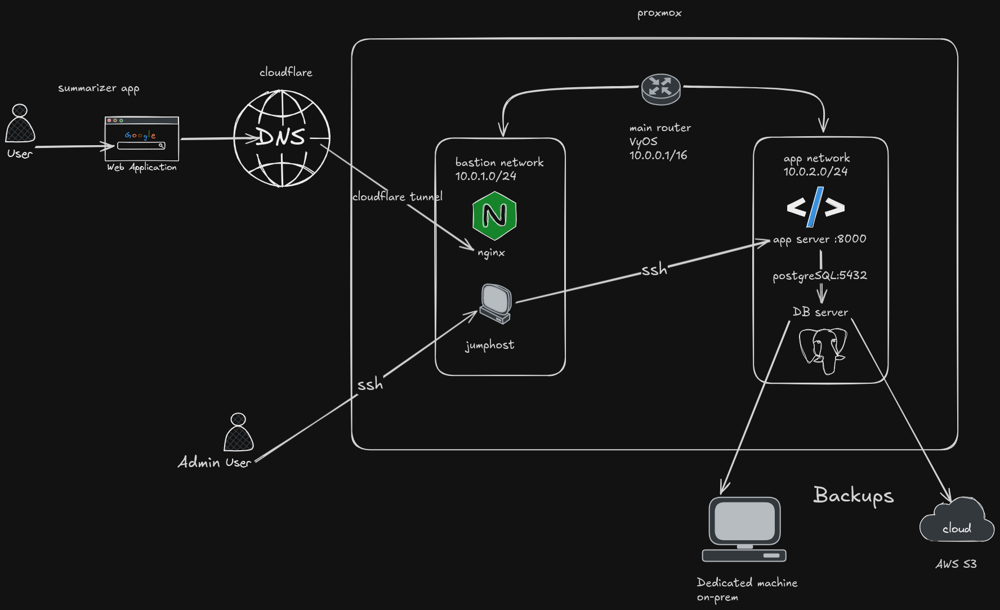

# Summarizer API

tl;dr: app summarizes Youtube stock related videos with a  RAG search for browsing historical data.

### Idea behind the project
I spend a lot of time watching YT videos about the stock market but I'm still not able to watch them all..
But luckily God gave us AI! So i made it (still making) watch it for me.

App is fully self-hosted. 

The back bone of my infrastructure.
For more details visit my second repo where i'll documenting my infra [infra_repo](https://github.com/paulmarketandtech/summarizer_infra)  

